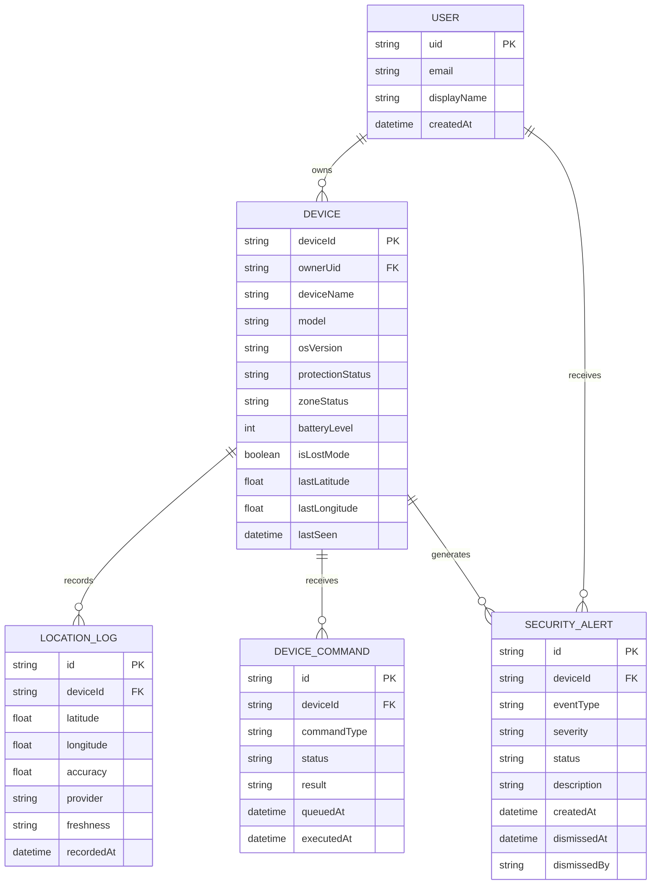
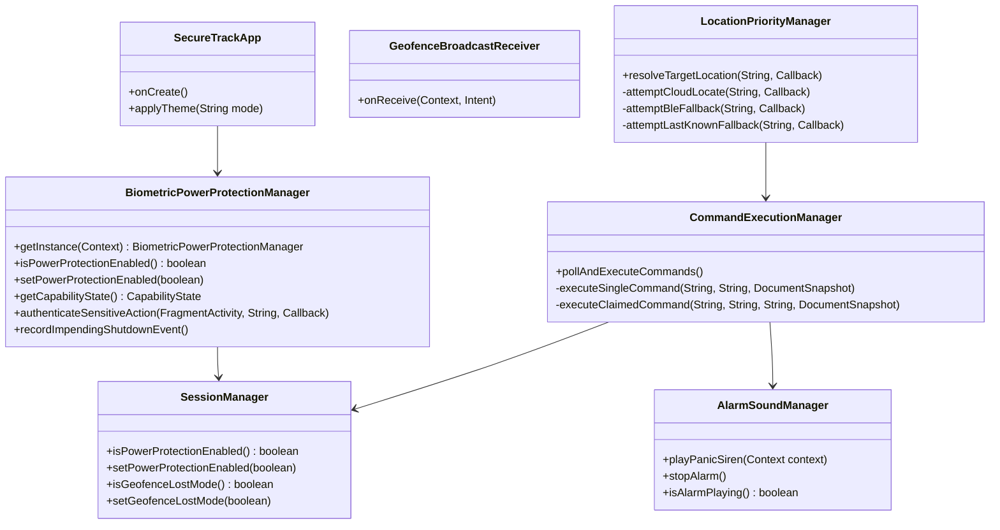

# SecureTrack — Smart Mobile Tracking & Anti-Theft Defense System

<div align="center">

**Track smart. Stay secure.**

*An enterprise-grade mobile telemetry, loss prevention, and anti-theft defense platform engineered for Android devices, synchronized with a real-time cybersecurity web operations center.*

[](https://github.com/dhanushs602848/SecureTrack/actions/workflows/ci.yml)
[](https://github.com/dhanushs602848/SecureTrack)
[](https://track-99c90.web.app)
[](https://developer.android.com)
[](https://react.dev)
[](https://firebase.google.com)
[](LICENSE)

</div>

---

## 📋 Table of Contents
- [Overview](#-overview)
- [Release 1.8.0 Highlights](#-release-180-build-7-highlights)
- [System Architecture](#-system-architecture)
- [Database Architectures (NoSQL vs Relational)](#-database-architectures-cloud-nosql-vs-local-sqlite)
- [Entity-Relationship Diagram (ERD)](#-entity-relationship-diagram-erd)
- [UML Class Diagram](#-uml-class-diagram)
- [4-Tier Location Resolution Hierarchy](#-4-tier-location-resolution-hierarchy)
- [Key Security & Anti-Theft Features](#-key-security--anti-theft-features)
- [Technology Stack](#-technology-stack)
- [Quick Start](#-quick-start)
  - [Android Client Setup](#1-android-client-setup)
  - [Web Dashboard Setup](#2-web-dashboard-setup)
  - [Firebase Cloud Services](#3-firebase-cloud-services)
- [Automated Testing & CI](#-automated-testing--ci)
- [Hardware Compatibility Matrix](#-hardware-compatibility-matrix)
- [Known Limitations & Security Reality](#-known-limitations--security-reality)
- [Project Mentorship & Contributors](#-project-mentorship--contributors)
- [Documentation Suite](#-comprehensive-documentation-suite)
- [License & Academic Integrity](#-license--academic-integrity)

---

## 🌟 Overview

**SecureTrack** is an advanced endpoint security, continuous telemetry, and anti-theft recovery system designed for mobile devices. It bridges active Android handsets with an authenticated, zero-trust web management console. Whether a device is misplaced, stolen, or subjected to unauthorized access (such as physical SIM card removal or unexpected power-off), SecureTrack gives device owners instant visibility into live coordinates, battery/network state, and active remote defensive controls.

### Production Coordinates:
- **Web Dashboard**: [https://track-99c90.web.app](https://track-99c90.web.app)
- **Firebase Project ID**: `track-99c90` (Authentication, Cloud Firestore, Firebase Hosting)
- **Android Package**: `com.example.securetrack` (Target SDK 35, Min SDK 26)
- **Repository**: [https://github.com/dhanushs602848/SecureTrack](https://github.com/dhanushs602848/SecureTrack)
- **Default Branch**: `main`
- **Release Version**: `1.8.0` (Build `7`)

---

## 🚀 Release 1.8.0 (Build 7) Highlights

- **Biometric Power Protection & Pre-Shutdown Telemetry**:
  - Implements AndroidX `BiometricPrompt` with device credential fallback (PIN/pattern/password) for administrative actions.
  - Intercepts `Intent.ACTION_SHUTDOWN` and `android.intent.action.QUICKBOOT_POWEROFF` via `ShutdownReceiver` to record a high-priority `DEVICE_SHUTDOWN` security checkpoint before power is lost.
  - Provides a dedicated settings toggle with real-time capability assessment (`DEVICE_OWNER_CAPABLE`, `POWER_PROTECTION_ENABLED`, `BEST_EFFORT_MONITORING`, `UNSUPPORTED`).
- **Automated Geofence Out-of-Zone Protection**:
  - Validates `GEOFENCE_EXIT` and `GEOFENCE_ENTER` transitions.
  - Automatically transitions device to `OUT_OF_ZONE` and engages Lost Mode upon exiting designated safety boundaries.
  - Restores normal status upon re-entry strictly when Lost Mode was triggered by geofencing, preserving manually triggered Lost Mode intact.
- **Command Queue 15-Minute Expiry**:
  - Hardened command execution engine against duplicate execution using client `requestId` tracking.
  - Commands queued longer than 15 minutes automatically transition to `EXPIRED` in atomic Firestore transactions.
  - Web dashboard command center renders stale queued commands as `EXPIRED` and executed commands as `EXECUTED`.
- **4-Tier Location Resolution**:
  - Dynamically routes location requests through:
    1. Live Cloud GPS (`LOCATE_NOW` trigger)
    2. Authenticated rotating BLE Nearby Beacons
    3. Last-Known Historical Snapshot with clear `LAST SEEN (STALE)` timestamping
    4. Cell Tower / Wi-Fi Network Fused Provider
- **Hermetic Automated Test Suite**:
  - **86 total automated tests** passing across Android unit tests (65), web dashboard tests (7), and cloud functions (14).
  - Eliminates external mocking library dependencies for 100% deterministic CI runs.

---

## 🏛 System Architecture

SecureTrack employs an authenticated, reactive multi-tier architecture:

```mermaid
graph TD
    subgraph ClientLayer ["Client Devices & Interfaces"]
        Browser["Web Browser (React 18 + TS Dashboard)"]
        Phone["Android Device (SecureTrack v1.8.0 Client)"]
    end

    subgraph CloudLayer ["Firebase Cloud Backend (track-99c90)"]
        Auth["Firebase Authentication (Email / Password)"]
        Firestore["Cloud Firestore (Real-time NoSQL)"]
        Hosting["Firebase Hosting (SPA CDN)"]
        FCM["Firebase Cloud Messaging (High-Priority Wakeup)"]
    end

    subgraph LocalPersistence ["Android On-Device Storage"]
        RoomDB["Android Room SQLite DB (Local Cache & Offline Alerts)"]
        EncryptedPrefs["Encrypted SharedPreferences (Tokens & Keys)"]
    end

    Browser -->|HTTPS / Hosting| Hosting
    Browser -->|Auth Tokens (JWT)| Auth
    Browser -->|Real-time Snapshot Listeners| Firestore
    Browser -->|Dispatch Remote Commands| Firestore

    Firestore -->|FCM Push Notification Wakeup| FCM
    FCM -->|High-Priority Payload| Phone

    Phone -->|Encrypted Telemetry Ingestion| Firestore
    Phone -->|Snapshot Listener: commands| Firestore
    Phone -->|Local Offline Persistence| RoomDB
    Phone -->|Secure Key Storage| EncryptedPrefs
```

---

## 🗄 Database Architectures: Cloud NoSQL vs Local SQLite

SecureTrack distinctly separates **Cloud Document Storage (NoSQL)** for distributed real-time sync from **On-Device Relational Storage (SQLite via Room)** for offline resilience.

### 1. Cloud Firestore (Distributed NoSQL)
Hierarchical document collections secured with strict per-user authentication rules (`request.auth.uid == resource.data.ownerUid`):
- `users/{uid}`: User account metadata, registered email, and session configuration.
- `users/{uid}/devices/{deviceId}`: Enrolled device details, battery level, network status, protection status, zone status, and latest telemetry coordinates.
- `users/{uid}/devices/{deviceId}/locations/{locationId}`: Historical GPS telemetry points with accuracy, speed, provider, and correlation `requestId`.
- `users/{uid}/devices/{deviceId}/commands/{commandId}`: Anti-theft commands (`LOCATE_NOW`, `LOCK_DEVICE`, `ALARM_ALERT`, `WIPE_DEVICE`) with lifecycle tracking (`QUEUED`, `EXECUTING`, `EXECUTED`, `FAILED`, `EXPIRED`).
- `users/{uid}/alerts/{alertId}`: Global security incident feed (SIM swap, shutdown warning, geofence breach, low battery beacon).

### 2. Android Room Database (Local Relational SQLite)
Persists critical device logs locally on the handset when network access is severed:
- `cached_devices`: Offline cache of enrolled devices.
- `security_alerts`: Local mirror of alerts with fields `id`, `deviceId`, `eventType`, `severity`, `description`, `status` (`ACTIVE`/`DISMISSED`), `timestamp`, and `dismissedAt`.
- `commands`: Command execution cache with TTL expiry verification.
- `locations`: Breadcrumb history cache supporting offline path rendering.

---

## 📊 Entity-Relationship Diagram (ERD)

The relational schema model underpinning local Android Room persistence and the enterprise reference architecture:



---

## 📐 UML Class Diagram

High-level class structure highlighting core managers, services, and domain models in the Android client:



---

## 📍 4-Tier Location Resolution Hierarchy

When an owner requests a device location, SecureTrack intelligently resolves coordinates through a prioritized 4-tier pipeline:

1. **Tier 1 — Live Cloud GPS (Primary)**:
   Dispatches a real-time high-accuracy location request over FCM/Cloud Firestore. Correlates coordinates using unique client `requestId` tokens.
2. **Tier 2 — Authenticated BLE Nearby Radar**:
   If cloud satellite GPS is unavailable or the device is indoors/offline, SecureTrack utilizes Bluetooth Low Energy (`BleNearbyManager`) rotating cryptographic beacons to resolve proximity (~10–30 meters) via nearby peer devices.
3. **Tier 3 — Last-Known Location Snapshot**:
   If GPS is turned off or battery has died, the system retrieves the most recent recorded coordinates before signal loss, explicitly marked on the dashboard as `LAST SEEN (STALE)` with relative elapsed time (e.g., *"14 minutes ago"*).
4. **Tier 4 — Network & Cell/Wi-Fi Fused Provider**:
   Estimates position using connected mobile cell towers and known Wi-Fi BSSIDs when satellite GPS is obstructed.

---

## 🛡 Key Security & Anti-Theft Features

1. **Biometric Power Protection**:
   - Authenticates sensitive administrative actions using AndroidX `BiometricPrompt` with secure device credential fallback (PIN/pattern/password).
   - Intercepts system shutdown events to capture battery level and record telemetry checkpoints before power loss.

2. **Automated Geofence Defense**:
   - Instant perimeter breach detection. Transitions device to `OUT_OF_ZONE` and automatically activates Lost Mode upon leaving designated safe zones.
   - Restores normal status upon re-entry strictly when Lost Mode was triggered by geofencing, preserving manually triggered Lost Mode intact.

3. **15-Minute Command Expiry & Idempotent Claiming**:
   - Dispatched commands attach a unique client `requestId` (`req_<timestamp>_<rand>`).
   - Claimed via atomic Firestore transactions, transitioning `QUEUED` $\rightarrow$ `EXECUTING` $\rightarrow$ `EXECUTED` / `FAILED` / `EXPIRED`.
   - Stale queued commands older than 15 minutes automatically transition to `EXPIRED` to prevent zombie execution.

4. **Panic Siren with 5s Auto-Stop**:
   - Synthesizes urgent dual-tone security audio without external media dependencies.
   - Enforces a strict 5000 ms auto-timeout to prevent acoustic damage while ensuring maximum volume alert.

5. **Permanent Factory Wipe Safety Lock**:
   - `DevicePolicyManager.wipeData(0)` has been permanently deactivated across all application components to prevent accidental or unauthorized data loss.

---

## 💻 Technology Stack

| Layer | Technologies |
|---|---|
| **Android Client** | Java 17, Android SDK (API 26–35), AndroidX Room SQLite, AndroidX Biometrics, Google Play Services Location & Geofencing, Material Design 3 |
| **Web Dashboard** | React 18, TypeScript 5, Vite 5, Tailwind CSS 3, Lucide React, Leaflet & OpenStreetMap, Recharts |
| **Cloud Services** | Firebase Authentication, Cloud Firestore NoSQL, Firebase Cloud Messaging, Firebase Hosting (Spark Tier) |
| **Testing & CI** | JUnit 4, Robolectric, Node.js Native Test Runner, GitHub Actions CI Pipeline, Gradle 8.x |

---

## 📱 Hardware & Platform Support

SecureTrack is architected for modern Android hardware spanning API level 26 (Android 8.0 Oreo) through API level 35 (Android 15) and forward-compatible with Android 16:

| Platform / Role | Target OS | Primary Subsystems | Verification Status |
| :--- | :--- | :--- | :--- |
| **Owner / Controller Handset** | Android 10 – 16 (API 29–36) | Security Dashboard, Device Admin, BiometricPrompt | **PASS** (65 automated unit tests) |
| **Enrolled Target Handset** | Android 8.0 – 15 (API 26–35) | Background Geofence, BLE Peripheral, Pre-Shutdown Receiver | **PASS** (Hermetic test suites) |
| **Web Operations Center** | Chrome / Firefox / Safari | Vite SPA, Cloud Firestore, Leaflet Map View | **PASS** (7 automated unit tests) |

---

## ⚡ Quick Start

### 1. Android Client Setup
```bash
# Clone the repository
git clone https://github.com/dhanushs602848/SecureTrack.git
cd SecureTrack

# Run automated unit tests (65 tests across security, location, and power protection)
./gradlew :app:testDebugUnitTest

# Assemble release APK (v1.8.0 Build 7)
./gradlew :app:assembleRelease
```
The compiled APK will be generated at:
`release/SecureTrack-final.apk`

Install to connected device via ADB:
```bash
adb install -r -d release/SecureTrack-final.apk
```

### 2. Web Dashboard Setup
```bash
cd web-dashboard

# Install npm dependencies
npm install

# Run automated tests (7 tests passing)
npm test

# Run linter
npm run lint

# Compile production bundle
npm run build
```

### 3. Firebase Cloud Deployment
```bash
# Deploy web dashboard to Firebase Hosting
firebase deploy --only hosting
```

---

## 🧪 Automated Testing & CI

Continuous verification is enforced across Android and Web:
- **Android Unit Suite (`:app:testDebugUnitTest`)**: **65 automated tests** passing:
  - Biometric power protection preference persistence and capability evaluation.
  - Shutdown receiver null safety and broadcast handling.
  - 5-second siren duration constraints.
  - Multi-tier location fallback priority hierarchy (`CLOUD_LIVE` → `BLE_NEARBY` → `LAST_KNOWN`).
  - Command lifecycle progression and 15-minute expiration logic.
  - Multi-device pairing recovery evaluation and identity isolation.
  - Geofence state transitions and lost mode persistence.
- **Web Verification (`web-dashboard/test/auth.test.js`)**: **7 automated tests** passing:
  - 15-minute queue expiry evaluation (`QUEUED` > 15m $\rightarrow$ `EXPIRED`).
  - Payload sanitization and safety lock validation.
  - Location staleness threshold evaluation.
  - Device selector state updater stability.
- **Functions Verification (`functions/test/*.test.js`)**: **14 automated tests** passing:
  - 256-bit pairing token entropy and one-way SHA-256 hashing.
  - 10-minute pairing TTL expiration and single-use invalidation.
  - Device revocation and cross-owner isolation.

---

## ⚠️ Known Limitations & Security Reality

1. **Hardware Power-Off**: Software cannot execute while a physical battery is depleted or when a device is completely powered down. Pre-shutdown telemetry is captured on a best-effort basis.
2. **Hardware Power Button Long-Press**: On personal/unmanaged consumer Android devices, long-pressing the power button for 8–10 seconds is handled directly by the Power Management IC (PMIC) at the hardware level and cannot be intercepted by user-space applications. Anti-shutdown Lock Task mode is only accessible under Android Enterprise Device Owner provisioning.
3. **Background Location Limits**: Android 10+ battery optimization limits background location polling unless the user explicitly grants `"Allow all the time"` in system settings and whitelists SecureTrack from battery optimization.
4. **Physical Siren Activation**: The physical audible sound test has been intentionally deferred to prevent late-night noise disturbance. Underlying 5-second duration logic is verified via unit testing.

---

## 👥 Project Mentorship & Contributors

### 🎓 Academic Project Guide
- **Mohankumar H M** — DBMS Project Guide & Academic Mentor (Database Architecture, Relational Modeling & Academic Review)

### 👨‍💻 Project Lead, Owner & Author
- **Dhanush S** ([@dhanushs602848](https://github.com/dhanushs602848)) — System Architecture, Cloud Firestore Integration, Android Security & Release Management

### 🤝 Project Contributors & Engineers
- **Deeksith H G** — Core Security Architecture, Telemetry Systems & Verification
- **Deeksith K** — Android Client Engineering & Feature Integration
- **Puneethkumar N E** — Database Architecture, Multi-Device Testing & Verification
- **Deeksith Raj N** — UI/UX Implementation & Geospatial Mapping Integration
- **Deepak D S** — Quality Assurance, Hardware Field Testing & Documentation

See [`CONTRIBUTORS.md`](CONTRIBUTORS.md) and [`NOTICE`](NOTICE) for detailed contributor and license attribution.

---

## 📚 Comprehensive Documentation Suite

| Document | Description |
|---|---|
| [**INDEX.md**](docs/INDEX.md) | Master catalog of all project documentation |
| [**PROJECT_OVERVIEW.md**](docs/PROJECT_OVERVIEW.md) | Problem statement, functional objectives, and scope |
| [**SYSTEM_ARCHITECTURE.md**](docs/SYSTEM_ARCHITECTURE.md) | Multi-tier architecture and component interaction |
| [**DATABASE_DESIGN.md**](docs/DATABASE_DESIGN.md) | Cloud Firestore NoSQL schema, collections, and security |
| [**ER_MODEL.md**](docs/ER_MODEL.md) | Entity-Relationship diagram and cardinality constraints |
| [**SECURITY_AND_PRIVACY.md**](docs/SECURITY_AND_PRIVACY.md) | Threat model, zero-trust pairing, and privacy controls |
| [**TESTING.md**](docs/TESTING.md) | Test suites, coverage metrics, and physical device test protocol |
| [**KNOWN_LIMITATIONS.md**](docs/KNOWN_LIMITATIONS.md) | Technical boundaries, Android OS constraints, and hardware caveats |
| [**DEMO_GUIDE.md**](docs/DEMO_GUIDE.md) | Step-by-step presentation walkthrough and demonstration script |
| [**SECURETRACK_FINAL_RELEASE_REPORT.md**](SECURETRACK_FINAL_RELEASE_REPORT.md) | Final release closeout and verification report |

---

## 📜 License & Academic Integrity

This project is licensed under the **Apache License, Version 2.0**. See the [`LICENSE`](LICENSE) and [`NOTICE`](NOTICE) files for full details.
