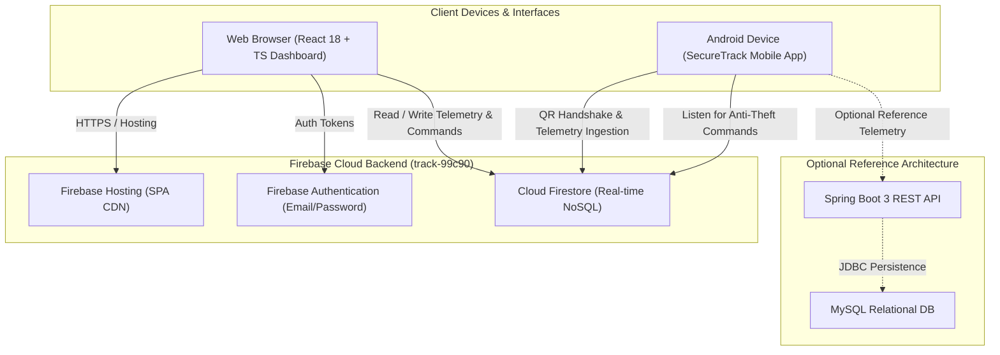

# SecureTrack — Smart Mobile Tracking & Anti-Theft System

<div align="center">

**Track smart. Stay secure.**

*A prototype mobile tracking and security monitoring system engineered for Android devices, featuring real-time telemetry, QR-based pairing, and administrative device controls.*

[](https://github.com/dhanushs602848/SecureTrack/actions/workflows/ci.yml)
[](https://track-99c90.web.app)
[](https://developer.android.com)
[](https://react.dev)
[](https://firebase.google.com)

</div>

---

## 📋 Table of Contents
- [Overview](#-overview)
- [System Architecture](#-system-architecture)
- [Key Features](#-key-features)
- [Technology Stack](#-technology-stack)
- [Quick Start](#-quick-start)
  - [Android Client Setup](#1-android-client-setup)
  - [Web Dashboard Setup](#2-web-dashboard-setup)
  - [Firebase Cloud Services](#3-firebase-cloud-services)
- [Automated Testing & CI](#-automated-testing--ci)
- [Documentation Suite](#-comprehensive-documentation-suite)
- [Security & Threat Model](#-security--threat-model)
- [Contributing & License](#-contributing--license)

---

## 🌟 Overview

**SecureTrack** is an end-to-end endpoint security and device recovery ecosystem. It pairs an active Android handset with a secure, real-time web administration portal. Whether a device is misplaced, subjected to unauthorized handling, or stolen, SecureTrack provides immediate visibility into geographic coordinates, device battery/network health, and provides remote security remediation tools.

### Production Environment:
- **Web Dashboard**: [https://track-99c90.web.app](https://track-99c90.web.app)
- **Firebase Project**: `track-99c90` (Authentication, Cloud Firestore, Firebase Hosting)
- **Repository**: [https://github.com/dhanushs602848/SecureTrack](https://github.com/dhanushs602848/SecureTrack)

---

## 🏛 System Architecture

SecureTrack employs a modern multi-tier cloud-synchronized architecture:



1. **Native Android Client (`app/`)**: Runs a persistent `LocationTrackingService` foreground service, uses Google Play Services `FusedLocationProviderClient`, binds `DevicePolicyManager` for remote lock/wipe, and features an integrated ZXing QR pairing scanner.
2. **Cloud Infrastructure (`firebase/`)**: Fully serverless, zero-cost Spark tier architecture. Cloud Firestore serves as the low-latency real-time state bus with declarative security rules.
3. **Web Management Dashboard (`web-dashboard/`)**: Single-Page Application (SPA) built with React 18, TypeScript, and Tailwind CSS, featuring Leaflet/OpenStreetMap geospatial visualization.
4. **Enterprise Reference Backend (`backend/`)**: Preserved Spring Boot 3 + MySQL relational reference architecture demonstrating traditional enterprise RDBMS persistence and Flyway migrations.

---

## 🚀 Key Features

- **QR-Based Device Pairing**: Enroll devices by scanning a single-use cryptographically random token (valid for 10 minutes) generated by the web client.
- **Continuous Real-Time Telemetry**: Real-time GPS coordinates, battery percentage, charging status, network type, and last-seen timestamps.
- **Remote Siren / Audible Alarm**: Sends a ring command to trigger an alert on the phone (Note: requires active testing across varying vendor OS power managers).
- **Remote Screen Lock**: Remotely lock lost devices via Android's `DevicePolicyManager` (requires Device Administrator permission enabled on device).
- **Owner-Authorized Device Revocation**: Decommission devices directly from the web dashboard with idempotent duplicate cleanup (note: Firestore root document deletion does not automatically delete subcollections).
- **Persistent Tracking**: Android `ForegroundService` with system notification and `BootReceiver` for restart upon phone reboot.

---

## 📷 Screenshots

> *Status: Screenshot capture from active physical test runs is documented in the test protocol. Physical device screenshots will be updated upon next test hardware cycle.*

| Web Dashboard Overview | Device List & Pairing Modal | Android Registration |
|:---:|:---:|:---:|
| *(Pending hardware capture)* | *(Pending hardware capture)* | *(Pending hardware capture)* |

---

## 💻 Technology Stack

| Layer | Technologies |
|---|---|
| **Android Client** | Java, Android SDK (API 26–35), Google Play Services Location & Maps, Material Components 3, ZXing Barcode Scanner |
| **Web Dashboard** | React 18, TypeScript 5, Vite 5, Tailwind CSS 3, Lucide React, Leaflet & OpenStreetMap |
| **Cloud Services** | Firebase Authentication, Cloud Firestore NoSQL, Firebase Hosting (Spark Plan) |
| **Enterprise Reference** | Spring Boot 3.2, Java 17/21, Spring Security, JJWT, MySQL 8.4, Flyway |
| **Tooling & CI** | GitHub Actions, Gradle 8.x, npm, Firebase CLI, Git |

---

## ⚡ Quick Start

### 1. Android Client Setup
```bash
# Clone the repository
git clone https://github.com/dhanushs602848/SecureTrack.git
cd SecureTrack

# Run unit tests
./gradlew testDebugUnitTest

# Assemble debug APK
./gradlew assembleDebug
```
The compiled APK will be located at `app/build/outputs/apk/debug/app-debug.apk`.  
Install via ADB:
```bash
adb install -r app/build/outputs/apk/debug/app-debug.apk
```

### 2. Web Dashboard Setup
```bash
cd web-dashboard

# Install dependencies
npm install

# Start local Vite development server
npm run dev

# Run automated web tests
node --test test/auth.test.js

# Build production bundle
npm run build
```

### 3. Firebase Cloud Services
```bash
# Deploy updated Firestore Security Rules
firebase deploy --only firestore:rules

# Deploy Web Dashboard to Firebase Hosting
firebase deploy --only hosting
```

---

## 🧪 Automated Testing & CI

Continuous Integration is automated via GitHub Actions (`.github/workflows/ci.yml`):
- **Web Build & Test**: Compiles TypeScript, bundles assets with Vite, and runs auth/validation tests.
- **Pairing & Revocation Suite**: 10 automated test cases in `functions/test/pairing.test.js` verifying token entropy, TTL expiration, single-use constraints, and safe device revocation.
- **Android Compilation & Tests**: Executes `:app:testDebugUnitTest` and builds `:app:assembleDebug`.

To run all local test suites manually:
```bash
# Pairing & Revocation cryptographic suite
node --test functions/test/pairing.test.js

# Web authentication tests
node --test web-dashboard/test/auth.test.js

# Android unit test suite
./gradlew :app:testDebugUnitTest
```

---

## 📚 Comprehensive Documentation Suite

Complete technical and architectural documentation is maintained in the [`docs/`](docs/) directory:

| Document | Description |
|---|---|
| [**INDEX.md**](docs/INDEX.md) | Master catalog and directory of all documentation |
| [**PROJECT_OVERVIEW.md**](docs/PROJECT_OVERVIEW.md) | Problem statement, functional objectives, and scope |
| [**SYSTEM_ARCHITECTURE.md**](docs/SYSTEM_ARCHITECTURE.md) | Multi-tier architecture and component interaction |
| [**DATABASE_DESIGN.md**](docs/DATABASE_DESIGN.md) | Cloud Firestore NoSQL schema, collections, and security |
| [**ER_MODEL.md**](docs/ER_MODEL.md) | Entity-Relationship diagram and cardinality constraints |
| [**NETWORK_MODEL.md**](docs/NETWORK_MODEL.md) | CODASYL network model representation |
| [**HIERARCHICAL_MODEL.md**](docs/HIERARCHICAL_MODEL.md) | Tree hierarchy and document-subcollection mapping |
| [**RELATIONAL_MODEL.md**](docs/RELATIONAL_MODEL.md) | MySQL schema reference, 1NF–3NF/BCNF normalization |
| [**XML_MODEL.md**](docs/XML_MODEL.md) | Android XML layouts and telemetry exchange XSD schema |
| [**OBJECT_ORIENTED_MODEL.md**](docs/OBJECT_ORIENTED_MODEL.md) | Domain class hierarchy, UML diagrams, and design patterns |
| [**FIREBASE_SETUP.md**](docs/FIREBASE_SETUP.md) | Cloud setup, Authentication, and Firestore configuration |
| [**ANDROID_SETUP.md**](docs/ANDROID_SETUP.md) | Android Studio SDK requirements, permissions, and build guide |
| [**WEB_DASHBOARD_SETUP.md**](docs/WEB_DASHBOARD_SETUP.md) | Vite, React, TypeScript setup, and build procedures |
| [**SECURITY_AND_PRIVACY.md**](docs/SECURITY_AND_PRIVACY.md) | Threat model, zero-trust pairing, and privacy controls |
| [**TESTING.md**](docs/TESTING.md) | Test suites, coverage metrics, and physical device test protocol |
| [**DEPLOYMENT.md**](docs/DEPLOYMENT.md) | Release assembly and Firebase deployment procedures |
| [**USER_GUIDE.md**](docs/USER_GUIDE.md) | End-user instructions and operational manual |
| [**DEMO_GUIDE.md**](docs/DEMO_GUIDE.md) | 5-minute college presentation script and walkthrough |
| [**KNOWN_LIMITATIONS.md**](docs/KNOWN_LIMITATIONS.md) | System boundaries, OS constraints, and hardware caveats |
| [**FUTURE_ENHANCEMENTS.md**](docs/FUTURE_ENHANCEMENTS.md) | Engineering roadmap (BLE mesh, geofencing, intruder capture) |
| [**TROUBLESHOOTING.md**](docs/TROUBLESHOOTING.md) | Diagnostic solutions for common issues |

---

## 🛡 Security & Threat Model

SecureTrack enforces security by design:
- **Least-Privilege Cloud Access**: Firestore Security Rules require `request.auth.uid == resource.data.ownerUid` for all device telemetry queries and mutations.
- **Cryptographic Token Verification**: Enrolling devices requires matching a single-use 256-bit token generated server-side.
- **Zero Plaintext Secrets**: No passwords or privileged service account keys are stored in client source code.

For vulnerability disclosure, please refer to [SECURITY.md](SECURITY.md).

---

## 🤝 Contributing & License

Contributions are welcome! Please review [CONTRIBUTING.md](CONTRIBUTING.md) before opening a pull request.

This repository is maintained for research, academic evaluation, and demonstration purposes. All rights reserved by the repository owner unless explicitly licensed otherwise.
