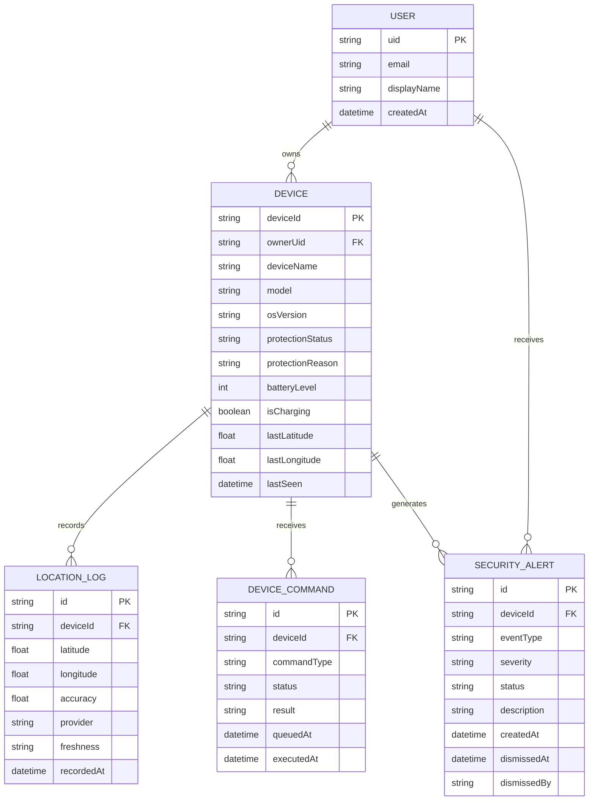
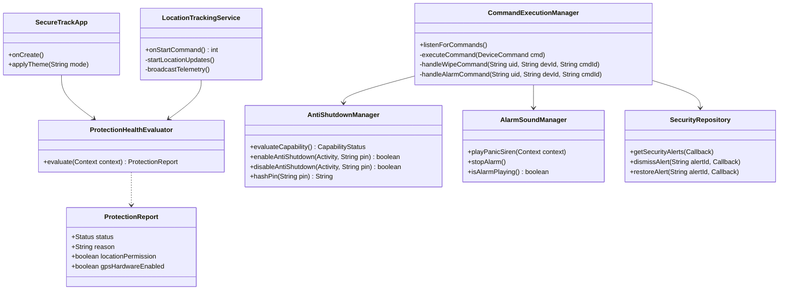

# SecureTrack — Smart Mobile Tracking & Anti-Theft Defense System

<div align="center">

**Track smart. Stay secure.**

*An enterprise-grade mobile telemetry, loss prevention, and anti-theft defense platform engineered for Android devices, synchronized with a real-time cybersecurity web operations center.*

[](https://github.com/dhanushs602848/SecureTrack/actions/workflows/ci.yml)
[](https://github.com/dhanushs602848/SecureTrack)
[](https://track-99c90.web.app)
[](https://developer.android.com)
[](https://react.dev)
[](https://firebase.google.com)

</div>

---

## 📋 Table of Contents
- [Overview](#-overview)
- [Release 1.5 Highlights](#-release-15-highlights)
- [System Architecture](#-system-architecture)
- [Database Architectures (NoSQL vs Relational)](#-database-architectures-cloud-nosql-vs-local-sqlite)
- [Entity-Relationship Diagram (ERD)](#-entity-relationship-diagram-erd)
- [UML Class Diagram](#-uml-class-diagram)
- [Key Security & Anti-Theft Features](#-key-security--anti-theft-features)
- [Technology Stack](#-technology-stack)
- [Quick Start](#-quick-start)
  - [Android Client Setup](#1-android-client-setup)
  - [Web Dashboard Setup](#2-web-dashboard-setup)
  - [Firebase Cloud Services](#3-firebase-cloud-services)
- [Automated Testing & CI](#-automated-testing--ci)
- [Known Limitations & Security Reality](#-known-limitations--security-reality)
- [Documentation Suite](#-comprehensive-documentation-suite)
- [License & Academic Integrity](#-license--academic-integrity)

---

## 🌟 Overview

**SecureTrack** is a unified endpoint security, continuous telemetry, and anti-theft recovery system designed for mobile devices. It connects active Android handsets with an authenticated, zero-trust web management console. Whether a device is misplaced, stolen, or subjected to unauthorized access (such as physical SIM card removal), SecureTrack gives device owners instant visibility into live coordinates, battery/network state, and active remote defensive controls.

### Production & Project Coordinates:
- **Web Dashboard**: [https://track-99c90.web.app](https://track-99c90.web.app)
- **Firebase Project ID**: `track-99c90` (Authentication, Cloud Firestore, Firebase Hosting)
- **Android Package**: `com.example.securetrack` (Target SDK 35, Min SDK 26)
- **Repository**: [https://github.com/dhanushs602848/SecureTrack](https://github.com/dhanushs602848/SecureTrack)
- **Branch**: `feature/securetrack-security-location-refresh`

---

## 🚀 Release 1.5 Highlights

- **Dynamic Theme System**: 3 selectable visual modes across both Android and Web: **Light**, **Dark (Deep Navy/Slate)**, and **System Default**, with zero contrast regressions.
- **Synthesized Panic Siren**: Integrated 5-second auto-stopping panic siren (`res/raw/panic_security_siren.wav`) synthesizing high-urgency multi-frequency alarm bursts. Manual override stops available across all activities, and web banners display real-time siren activation alerts.
- **Accurate Telemetry & Geospatial Centering**: Dynamic `ChangeMapView` centers on genuine coordinates (e.g., `13.06938, 77.53035`), eliminating hardcoded placeholder coordinates. Telemetry freshness labels clearly distinguish `LIVE`, `STALE (CACHED)`, and `LOCATION OFF` states.
- **Protection Health Matrix**: Multi-factor hardware & permission evaluator categorizes device state into `ACTIVE`, `DEGRADED`, `NEEDS_ATTENTION`, or `OFFLINE` with explicit diagnostic causes (e.g. *"Location services switched off in system settings"*).
- **Anti-Shutdown Capability Analysis**: Distinguishes unmanaged personal phones from Enterprise Device Owner mode. Transparently communicates that consumer hardware power-cut buttons cannot be overridden by user-space apps, and implements Lock Task mode (`LOCK_TASK_FEATURE_NONE`) with PIN recovery for managed devices.
- **Permanent Wipe Safety Lock**: Completely disables `dpm.wipeData(0)` across the Android client, web dashboard, and cloud command executor to prevent accidental or unauthorized data loss.

---

## 🏛 System Architecture

SecureTrack employs an authenticated, reactive multi-tier architecture:

```mermaid
graph TD
    subgraph ClientLayer ["Client Devices & Interfaces"]
        Browser["Web Browser (React 18 + TS Dashboard)"]
        Phone["Android Device (SecureTrack v1.5 Client)"]
    end

    subgraph CloudLayer ["Firebase Cloud Backend (track-99c90)"]
        Auth["Firebase Authentication (Email / Password)"]
        Firestore["Cloud Firestore (Real-time NoSQL)"]
        Hosting["Firebase Hosting (SPA CDN)"]
    end

    subgraph LocalPersistence ["Android On-Device Storage"]
        RoomDB["Android Room SQLite DB (Local Cache & Offline Alerts)"]
        EncryptedPrefs["Encrypted SharedPreferences (Tokens & Keys)"]
    end

    subgraph EnterpriseRef ["Optional Reference Architecture"]
        SpringBoot["Spring Boot 3 REST API"]
        MySQL["MySQL Relational DB (Reference Only)"]
    end

    Browser -->|HTTPS / Hosting| Hosting
    Browser -->|Auth Tokens (JWT)| Auth
    Browser -->|Real-time Snapshot Listeners| Firestore

    Phone -->|HMAC-SHA256 Telemetry Ingestion| Firestore
    Phone -->|Snapshot Listener: commands| Firestore
    Phone -->|Local Offline Persistence| RoomDB
    Phone -->|Secure Key Storage| EncryptedPrefs
    Phone -.->|Optional Reference Sync| SpringBoot
    SpringBoot -.->|Flyway / JPA| MySQL
```

---

## 🗄 Database Architectures: Cloud NoSQL vs Local SQLite

SecureTrack distinctly separates **Cloud Document Storage (NoSQL)** for distributed real-time sync from **On-Device Relational Storage (SQLite via Room)** for offline resilience.

### 1. Cloud Firestore (Distributed NoSQL)
Hierarchical document collections secured with per-user authentication rules (`request.auth.uid == resource.data.ownerUid`):
- `users/{uid}`: User account metadata, registered email, and subscription level.
- `users/{uid}/devices/{deviceId}`: Enrolled device details, battery level, network status, protection status, and last telemetry coordinates.
- `users/{uid}/devices/{deviceId}/locations/{locationId}`: Historical GPS telemetry points with accuracy, speed, altitude, and source provider.
- `users/{uid}/devices/{deviceId}/commands/{commandId}`: Anti-theft commands (`LOCATE_NOW`, `LOCK_DEVICE`, `ALARM_ALERT`, `WIPE_DEVICE`) with lifecycle tracking (`QUEUED`, `EXECUTING`, `EXECUTED`, `FAILED`, `EXPIRED`).
- `users/{uid}/alerts/{alertId}`: Global security incident feed (SIM swap, panic siren, battery drop) supporting non-destructive dismissal and undo restoration.

### 2. Android Room Database (Local Relational SQLite)
Persists critical device logs locally on the handset when network access is severed:
- `security_alerts`: Local mirror of alerts with fields `id`, `deviceId`, `eventType`, `severity`, `description`, `status` (`ACTIVE`/`DISMISSED`), `timestamp`, and `dismissedAt`.
- `commands`: Command execution cache with TTL expiry verification.
- `locations`: Breadcrumb history cache supporting offline path rendering.

---

## 📊 Entity-Relationship Diagram (ERD)

The relational schema model underpinning local Android Room persistence and the enterprise reference architecture:



---

## 📐 UML Class Diagram

High-level class structure highlighting core managers, services, and domain models in the Android client:



---

## 🛡 Key Security & Anti-Theft Features

1. **Panic Siren with 5s Auto-Stop**:
   - Synthesizes urgent dual-tone security audio without external media dependencies.
   - Enforces a strict 5000 ms auto-timeout to prevent acoustic damage while ensuring maximum volume alert.
   - Idempotent alert emission into Firestore (`SECURITY_ALARM_TRIGGERED`), instantly surfacing on the web dashboard banner.

2. **Accurate Telemetry & Centering**:
   - Real-time coordinates (`latitude`, `longitude`, `accuracy`, `provider`) stream to Cloud Firestore.
   - Web Leaflet map uses dynamic reactive re-centering (`ChangeMapView`) to ensure the map instantly pans to device coordinates (e.g. `13.06938, 77.53035`).
   - If coordinates are unavailable, a clean "No Location Telemetry Available" empty state is displayed rather than fake coordinates.

3. **Multi-Factor Protection Health**:
   - Continuously evaluates GPS provider state, Location runtime permissions, Bluetooth hardware state, and internet connectivity.
   - Never displays `Active` when location is turned off; reports clear diagnostic feedback (`DEGRADED`, `NEEDS_ATTENTION`, or `OFFLINE`).

4. **Permanent Factory Wipe Safety Lock**:
   - `DevicePolicyManager.wipeData(0)` has been permanently deactivated across all application components.
   - Any remote wipe command dispatched via API is intercepted and rejected with: *"Safety Lock: Factory wipe is permanently disabled in this release to protect user data."*

5. **Anti-Shutdown Analysis**:
   - Detects whether the app has Android Enterprise Device Owner provisioning.
   - For consumer devices, transparently explains OS security boundaries (hardware power button cut cannot be overridden by user-space apps).
   - For Device Owner environments, configures Lock Task mode (`LOCK_TASK_FEATURE_NONE`) with PIN exit verification.

---

## 💻 Technology Stack

| Layer | Technologies |
|---|---|
| **Android Client** | Java 17, Android SDK (API 26–35), AndroidX Room SQLite, Google Play Services Location & Fused Location, ZXing Barcode Scanner, Material Design 3 |
| **Web Dashboard** | React 18, TypeScript 5, Vite 5, Tailwind CSS 3, Lucide React, Leaflet & OpenStreetMap, Recharts |
| **Cloud Services** | Firebase Authentication (Email/Password), Cloud Firestore NoSQL, Firebase Hosting (Spark Tier) |
| **Enterprise Reference** | Spring Boot 3.2, Java 17, Spring Data JPA, MySQL 8.4, Flyway Migration Engine |
| **Testing & CI** | JUnit 4, Robolectric, GitHub Actions CI Pipeline, Gradle 8.x |

---

## ⚡ Quick Start

### 1. Android Client Setup
```bash
# Clone the repository
git clone https://github.com/dhanushs602848/SecureTrack.git
cd SecureTrack

# Run automated unit tests (28 tests across security, location, and themes)
./gradlew :app:testDebugUnitTest

# Assemble production debug APK (v1.5)
./gradlew :app:assembleDebug
```
The compiled APK will be generated at:
`app/build/outputs/apk/debug/app-debug.apk`

Install to connected device via ADB:
```bash
adb install -r app/build/outputs/apk/debug/app-debug.apk
```

### 2. Web Dashboard Setup
```bash
cd web-dashboard

# Install npm dependencies
npm install

# Run local development server with HMR
npm run dev

# Run automated tests
node --test test/auth.test.js

# Compile production bundle
npm run build
```

### 3. Firebase Cloud Services
```bash
# Deploy updated security rules
firebase deploy --only firestore:rules

# Deploy dashboard to Firebase Hosting
firebase deploy --only hosting
```

---

## 🧪 Automated Testing & CI

Continuous verification is enforced across Android and Web:
- **Android Unit Suite (`:app:testDebugUnitTest`)**: **28 automated tests** passing:
  - 5-second siren duration constraints.
  - Multi-tier location fallback priority hierarchy (`CLOUD_LIVE` → `BLE_NEARBY` → `LAST_KNOWN` → `FIND_HUB_READY`).
  - Cryptographic HMAC-SHA256 BLE nearby key derivation and proof verification.
  - Command lifecycle progression and duplicate execution prevention.
  - Non-destructive alert dismissal and restoration (dismissing 5 alerts to 0, restoring to 1, adding new).
  - Anti-shutdown capability evaluation (personal unmanaged vs Device Owner Lock Task).
  - Remote wipe safety lock permanent rejection verification.
  - Android theme configuration and session manager persistence.
- **Web Verification**: Clean TypeScript typecheck (`tsc`) and production Vite compilation.
- **Pairing Suite (`functions/test/pairing.test.js`)**: 10 tests verifying 256-bit token entropy, 10-minute TTL expiration, and single-use invalidation.

---

## ⚠️ Known Limitations & Security Reality

1. **Hardware Power-Off**: Like all commercial Android security products, software cannot execute while a physical battery is depleted or when a device is completely powered down.
2. **Hardware Power Button Long-Press**: On personal/unmanaged devices, Android hardware forced shutdown (holding power for 8-10 seconds) is executed by the power management integrated circuit (PMIC) and cannot be intercepted by third-party applications. Anti-shutdown Lock Task mode is only accessible under Android Enterprise Device Owner provisioning.
3. **Background Location Limits**: Android 10+ battery optimization limits background location polling unless the user explicitly grants `"Allow all the time"` in system settings and whitelists SecureTrack from battery optimization.
4. **Single-Device Testing Environment**: Physical verification performed using Samsung Galaxy A07 (`SM-A076B`). Multi-device pairing tested through single-device enrollment and web dashboard administration.

---

## 📚 Comprehensive Documentation Suite

| Document | Description |
|---|---|
| [**INDEX.md**](docs/INDEX.md) | Master catalog of all project documentation |
| [**PROJECT_OVERVIEW.md**](docs/PROJECT_OVERVIEW.md) | Problem statement, functional objectives, and scope |
| [**SYSTEM_ARCHITECTURE.md**](docs/SYSTEM_ARCHITECTURE.md) | Multi-tier architecture and component interaction |
| [**DATABASE_DESIGN.md**](docs/DATABASE_DESIGN.md) | Cloud Firestore NoSQL schema, collections, and security |
| [**ER_MODEL.md**](docs/ER_MODEL.md) | Entity-Relationship diagram and cardinality constraints |
| [**SECURITY_AND_PRIVACY.md**](docs/SECURITY_AND_PRIVACY.md) | Threat model, zero-trust pairing, and privacy controls |
| [**TESTING.md**](docs/TESTING.md) | Test suites, coverage metrics, and physical device test protocol |
| [**KNOWN_LIMITATIONS.md**](docs/KNOWN_LIMITATIONS.md) | Technical boundaries, Android OS constraints, and hardware caveats |
| [**DEMO_GUIDE.md**](docs/DEMO_GUIDE.md) | Step-by-step presentation walkthrough and demonstration script |

---

## 🤝 License & Academic Integrity

This project is developed for research, academic evaluation, and demonstration purposes. All rights reserved by the repository owner unless explicitly licensed otherwise.
