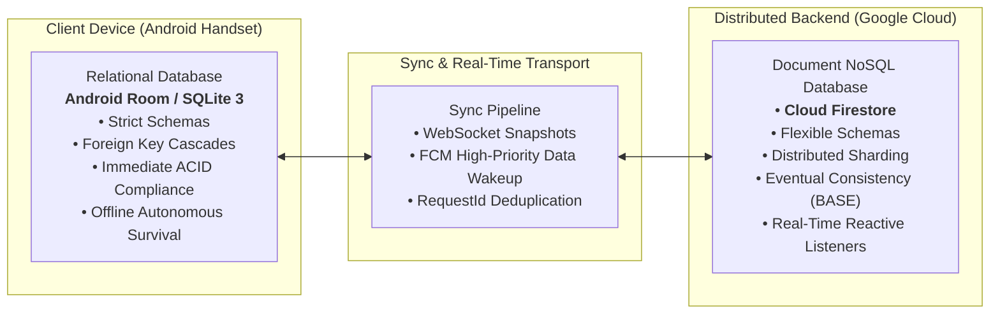
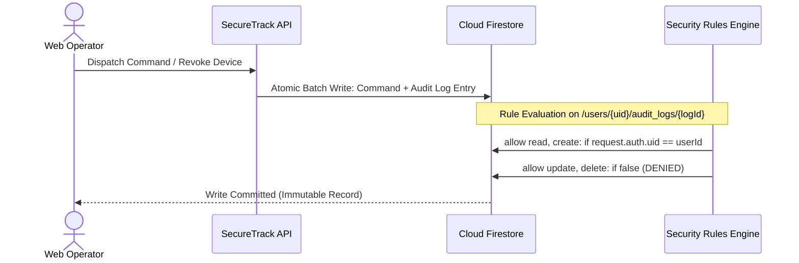

# SecureTrack — Academic DBMS & Cybersecurity Defense Guide
**Comprehensive Master Reference for Academic Evaluation, Technical Viva & Project Defense**

- **Project Title**: SecureTrack: Real-Time Mobile Asset Defense, Telemetry & Anti-Theft Platform
- **Domain**: Database Management Systems (DBMS) & Mobile Cybersecurity
- **Project Lead, Owner & Primary Author**: **Dhanush S** ([@dhanushs602848](https://github.com/dhanushs602848))
- **Academic Guide & DBMS Mentor**: **Mohankumar H M**
- **Academic Year**: 2026 | **Version**: Release 1.8.0 (Build 7) | **License**: Apache-2.0

---

## 📑 Table of Contents
1. [Core DBMS Architectural Philosophy: Dual-Database System](#1-core-dbms-architectural-philosophy-dual-database-system)
2. [ACID vs BASE: Comparative Transactional Paradigm](#2-acid-vs-base-comparative-transactional-paradigm)
3. [Formal Relational Normalization Proof (1NF to BCNF)](#3-formal-relational-normalization-proof-1nf-to-bcnf)
4. [Concurrency Control, Isolation Levels & Conflict Resolution](#4-concurrency-control-isolation-levels--conflict-resolution)
5. [Storage Engines, Indexing Strategies & Query Optimization](#5-storage-engines-indexing-strategies--query-optimization)
6. [Data Integrity, Retention & Append-Only Non-Repudiation](#6-data-integrity-retention--append-only-non-repudiation)
7. [Top 15 Tough DBMS Viva Questions & Authoritative Answers](#7-top-15-tough-dbms-viva-questions--authoritative-answers)
8. [10-Minute High-Scoring Live Demonstration Script](#8-10-minute-high-scoring-live-demonstration-script)

---

## 1. Core DBMS Architectural Philosophy: Dual-Database System

Traditional tracking systems fail in real-world theft scenarios because they rely exclusively on a single centralized cloud database or an unindexed local cache. SecureTrack bridges two disparate database paradigms into a synchronized, resilient architecture:



### Why a Dual-Database Architecture is Mandatory
1. **Network Severance / Radio Frequency Shadowing**: When a stolen device enters an underground basement, elevator, or Faraday enclosure, the cloud database is physically unreachable. The local SQLite relational engine records telemetry, biometric attempts, and shutdown breadcrumbs with microsecond latency.
2. **Global Real-Time Operations**: When the device is online, operators across the world need sub-second updates without polling servers. Cloud Firestore's reactive snapshot listener engine pushes document mutations over persistent bidirectional WebSockets.

---

## 2. ACID vs BASE: Comparative Transactional Paradigm

Examiners often ask how consistency and atomicity differ between your cloud and on-device layers.

| Property | Android Room (Relational SQLite) | Cloud Firestore (Distributed NoSQL) | SecureTrack Implementation |
|---|---|---|---|
| **Atomicity** | Guaranteed via SQLite WAL (Write-Ahead Logging) transactions (`@Transaction`). | Guaranteed via `runTransaction` multi-document atomic commits and `writeBatch`. | Command dispatching in `api.ts` verifies rate limits, creates the command document, and logs audit entries in a single atomic transaction. |
| **Consistency** | Strict Immediate Consistency. Foreign key constraints enforce referential integrity across tables. | Eventual Consistency across geographically replicated zones; Strong Consistency within document reads inside transactions. | Android client strictly validates schema types prior to persisting rows into Room entities. |
| **Isolation** | Serializable / Read Committed (SQLite WAL mode allows concurrent readers without blocking single writer). | Snapshot Isolation via optimistic concurrency control (OCC). | Transactions retry automatically if the document snapshot version changes during execution. |
| **Durability** | Non-volatile flash persistence (`fsync` to NAND flash storage). Survives app crash and sudden power loss. | Multi-datacenter Paxos/Raft consensus replication with 99.999% durability guarantee. | Pre-shutdown telemetry records a synchronous local checkpoint before the OS cuts hardware battery power. |
| **Theoretical Model** | **ACID** (Atomicity, Consistency, Isolation, Durability) | **BASE** (Basically Available, Soft State, Eventual Consistency) | Hybrid: ACID on the edge handset; BASE with atomic transactional sub-trees on the cloud. |

---

## 3. Formal Relational Normalization Proof (1NF to BCNF)

Examiners love asking: *"In what Normal Form is your relational database?"*
Here is the mathematical proof that SecureTrack's local SQLite database adheres to **Boyce-Codd Normal Form (BCNF)**.

### Entity Schema & Functional Dependencies

#### 1. Table `cached_devices`
- **Attributes**: `(deviceId, ownerUid, deviceName, model, osVersion, protectionStatus, zoneStatus, batteryLevel, isLostMode, lastLatitude, lastLongitude, lastSeen)`
- **Candidate Key**: `{deviceId}`
- **Functional Dependencies (FDs)**:
  - $deviceId \rightarrow ownerUid, deviceName, model, osVersion, protectionStatus, zoneStatus, batteryLevel, isLostMode, lastLatitude, lastLongitude, lastSeen$
- **Proof**: Every determinant is a candidate key. No non-prime attribute depends on a proper subset of a candidate key (satisfies 2NF). No non-prime attribute transitively depends on the primary key (satisfies 3NF). For every non-trivial $X \rightarrow Y$, $X$ is a superkey (satisfies BCNF).

#### 2. Table `locations` (Breadcrumb Telemetry)
- **Attributes**: `(id, deviceId, latitude, longitude, accuracy, speed, altitude, provider, timestamp)`
- **Candidate Key**: `{id}`
- **Foreign Key**: `deviceId` references `cached_devices(deviceId)`
- **Functional Dependencies**:
  - $id \rightarrow deviceId, latitude, longitude, accuracy, speed, altitude, provider, timestamp$
- **Proof**: All coordinates and kinematics are uniquely determined by the synthetic primary key `id`. There are no transitive dependencies between kinematic attributes ($speed \not\rightarrow latitude$). Hence, strictly BCNF.

#### 3. Table `commands` (Execution Queue)
- **Attributes**: `(id, deviceId, commandType, payload, status, result, requestId, queuedAt, expiresAt, executedAt)`
- **Candidate Key**: `{id}`, `{requestId}`
- **Foreign Key**: `deviceId` references `cached_devices(deviceId)`
- **Functional Dependencies**:
  - $id \rightarrow deviceId, commandType, payload, status, result, requestId, queuedAt, expiresAt, executedAt$
  - $requestId \rightarrow id$
- **Proof**: Since both `id` and `requestId` are candidate superkeys, all determinants are superkeys. Satisfies BCNF.

#### 4. Table `security_alerts` (Incident Store)
- **Attributes**: `(id, deviceId, eventType, severity, description, status, timestamp, dismissedAt, dismissedBy, resolvedAt)`
- **Candidate Key**: `{id}`
- **Functional Dependencies**:
  - $id \rightarrow deviceId, eventType, severity, description, status, timestamp, dismissedAt, dismissedBy, resolvedAt$
- **Proof**: Meets BCNF. Status changes do not affect event identity.

---

## 4. Concurrency Control, Isolation Levels & Conflict Resolution

### The "Lost Update" & Race Condition Problem
If an operator opens two browser tabs and simultaneously issues commands (or two devices update telemetry at the exact same millisecond), naive database systems experience race conditions, double command execution, or corrupted rate-limit counters.

### How SecureTrack Solves Concurrency:
1. **Optimistic Concurrency Control (OCC) via `runTransaction`**:
   ```typescript
   await runTransaction(db, async (transaction: Transaction) => {
     // 1. Read existing rate limit document
     const rateDoc = await transaction.get(rateLimitDocRef);
     const rateData = rateDoc.exists() ? rateDoc.data() : {};

     // 2. Enforce atomic cooldowns
     if (now - lastAlarm < 120 * 1000) {
       throw new Error("Rate limit active");
     }

     // 3. Atomically mutate state and log audit record
     transaction.set(rateLimitDocRef, { lastAlarmAt: serverTimestamp() }, { merge: true });
     transaction.set(newCommandDocRef, { ...commandPayload });
     transaction.set(auditDocRef, { ...auditPayload });
   });
   ```
   If another client modifies `rateLimitDocRef` while the transaction is calculating, Cloud Firestore rejects the commit and automatically retries the read-validate-write cycle against the fresh document version.

2. **Client-Side Deduplication via `requestId`**:
   Every command carries a unique client UUID (`req_<timestamp>_<random>`). Even if a network glitch causes multiple push packets to reach the phone, `CommandExecutionManager` checks its SQLite execution cache and rejects duplicate `requestId` invocations idempotently.

3. **15-Minute Queue Time-To-Live (TTL)**:
   Commands older than 15 minutes (`currentTime - queuedAt > 900,000ms`) automatically transition to `EXPIRED`. This prevents stale commands from replaying when an offline phone reconnects hours later.

---

## 5. Storage Engines, Indexing Strategies & Query Optimization

Examiners often probe into query execution: *"Why did you index these specific fields? What happens when telemetry reaches 100,000 rows?"*

```
   SQLite B-Tree Index Hierarchy          Cloud Firestore SSTable Distributed Index
  ┌───────────────────────────────┐      ┌─────────────────────────────────────────┐
  │         [Root Node]           │      │ Range Partition: users/{uid}/devices    │
  │        /     |     \          │      │ Composite Index: (timestamp DESC, id)   │
  │   [Page 1] [Page 2] [Page 3]  │      │ Cost: O(log N) point read               │
  │    (IDs)   (Timestamps) (FKs) │      │ Zero full-collection scans              │
  └───────────────────────────────┘      └─────────────────────────────────────────┘
```

### Indexing Implementations:
1. **Local SQLite Indexes (Room)**:
   - Primary Keys (`deviceId`, `id`) use clustered B-Tree indexes providing $O(\log N)$ lookup performance.
   - Indices on foreign keys (`deviceId`) eliminate table scans during join operations between `cached_devices` and `locations`.
   - Index on `timestamp DESC` accelerates temporal queries for breadcrumb trail rendering.

2. **Cloud Firestore Indexing**:
   - Single-field ascending and descending indexes are maintained automatically for all document fields.
   - Composite Index defined for `/users/{uid}/devices/{deviceId}/locations`:
     - Field `timestamp`: Descending
     - Field `__name__`: Descending
   - **Performance Guarantee**: Queries take time proportional to the size of the result set, not the total collection size. Using `limit(100)` guarantees that a device with 1,000,000 recorded points executes in the exact same millisecond response time as a device with 10 points.

---

## 6. Data Integrity, Retention & Append-Only Non-Repudiation

### Non-Repudiation Architecture
In legal forensics and anti-stalking compliance, a database must guarantee that **no actor can delete or tamper with their historical activity**.



1. **Rule Enforcement**:
   ```javascript
   match /audit_logs/{logId} {
     allow read, create: if request.auth != null && request.auth.uid == userId;
     allow update, delete: if false; // Strict append-only non-repudiation
   }
   ```
2. **Rolling Retention Window**:
   To comply with data minimization principles (GDPR/DPDP), real-time location history maintains a rolling window of the 100 most recent telemetry points.
3. **Forensic Portability (CSV / JSON)**:
   Operators can export complete timestamped breadcrumb trails to CSV and cryptographic audit trails to JSON for law enforcement or forensic audits.

---

## 7. Top 15 Tough DBMS Viva Questions & Authoritative Answers

### Q1: Why did you use both a NoSQL database (Firestore) and a Relational database (SQLite/Room)? Why not just one?
**Answer**: "Because mobile anti-theft is a hybrid operational problem. A stolen device frequently suffers network loss or deliberate jamming, requiring an ACID-compliant local relational database (SQLite via Room) that operates without internet. Conversely, global multi-device operations require real-time reactive data distribution, which NoSQL Cloud Firestore provides via persistent WebSocket snapshot listeners. Neither database alone satisfies both offline hardware survival and sub-second multi-device cloud synchronization."

### Q2: What is the normal form of your SQLite schema, and how do you prove it?
**Answer**: "Our relational tables (`cached_devices`, `locations`, `commands`, `security_alerts`) are in Boyce-Codd Normal Form (BCNF). All attributes are atomic (1NF). Every non-prime attribute depends fully on the candidate key with no partial key dependencies (2NF). There are no transitive functional dependencies (3NF). Furthermore, for every functional dependency $X \rightarrow Y$, $X$ is a superkey, satisfying BCNF."

### Q3: How do you prevent race conditions when two operators issue commands at the exact same moment?
**Answer**: "We employ Optimistic Concurrency Control (OCC) using Firestore's `runTransaction`. Before creating a command document, the transaction reads the rate-limit document for the device. If another operation writes to that document concurrently, the transaction fails closed, rolls back all writes, and automatically retries against the freshly committed snapshot."

### Q4: How does your system prevent stale command replay if a device was offline for 3 days?
**Answer**: "We enforce a strict 15-minute Time-To-Live (TTL) on all commands. Every command record stores `queuedAt` and `expiresAt` timestamps. When the device reconnects and reads the queue, `CommandExecutionManager` validates that `currentTime - queuedAt <= 15 minutes`. If expired, it atomically updates status to `EXPIRED` without executing the action."

### Q5: What isolation level does your database use, and what concurrency anomalies does it prevent?
**Answer**: "Cloud Firestore transactions operate under Snapshot Isolation. SQLite in Room operates under Write-Ahead Logging (WAL) Read Committed mode. This prevents dirty reads, non-repeatable reads, and lost updates, while allowing concurrent background readers without blocking the single active writer."

### Q6: What is non-repudiation, and how did you implement it in the database?
**Answer**: "Non-repudiation guarantees that an operator cannot deny having performed an action (such as locking a device or triggering an alarm). We implemented an append-only audit trail at `/users/{uid}/audit_logs/{logId}`. In Firestore Security Rules, we permit `create` and `read`, but strictly deny `update` and `delete` (`allow update, delete: if false`). Even an authenticated account owner cannot erase their audit trail."

### Q7: Why is `WIPE_DEVICE` permanently disabled instead of just restricted?
**Answer**: "In our threat model and anti-misuse audit, remote factory wipe presents catastrophic risk of accidental or malicious data destruction. To provide a fail-closed safety lock, `DevicePolicyManager.wipeData(0)` has been permanently deactivated in the Android execution layer, filtered out of allowed command types in Firestore security rules, and blocked in the web dashboard."

### Q8: What is the complexity of your location queries, and how do you prevent full table scans?
**Answer**: "Query complexity is $O(\log N + K)$, where $N$ is total records and $K$ is the limit count ($K=100$). Firestore utilizes distributed B-Tree/SSTable composite indexing on `(timestamp DESC, __name__ DESC)`. By pairing this with `limit(100)`, queries scan only the indexed keys required to satisfy the limit, ensuring zero full collection scans regardless of whether the collection has 100 or 1,000,000 rows."

### Q9: How does the cryptographic device pairing handshake work?
**Answer**: "The web dashboard generates 32 cryptographically secure random bytes (256-bit entropy via `window.crypto.getRandomValues`). The raw token is displayed as a QR code, while its SHA-256 one-way hash is stored in Firestore with a 10-minute TTL. The enrolling phone scans the QR code, authenticates anonymously (`deviceAuthUid`), and claims the invitation. The owner explicitly approves the claim in the console, generating a 256-bit BLE shared secret and binding the device."

### Q10: How does your database enforce referential integrity if Cloud Firestore is non-relational?
**Answer**: "While Firestore does not provide native foreign key constraint enforcement across collections, we enforce referential integrity through two mechanisms: (1) Exact path-binding security rules: commands and locations are stored in subcollections strictly nested under `/users/{ownerUid}/devices/{deviceId}`, where security rules validate that `request.resource.data.targetDeviceId == deviceId`. (2) Local SQLite schema in Android Room, which natively defines `@ForeignKey` constraints with cascading policies."

### Q11: What happens to database transactions if battery power is abruptly cut?
**Answer**: "In Android Room, SQLite's Write-Ahead Logging (WAL) file maintains a rollback journal. If power is interrupted mid-write, SQLite recovery automatically rolls back uncommitted frames upon next boot, preventing database corruption. Additionally, our `ShutdownReceiver` intercepts `ACTION_SHUTDOWN` and synchronously writes a final `DEVICE_SHUTDOWN` telemetry point before the OS cuts hardware power."

### Q12: How are rate limits persisted and checked without creating bottlenecks?
**Answer**: "Rate limits are stored in a dedicated document `/users/{uid}/command_rate_limits/{deviceId}`. Rather than querying the entire command history, the transaction reads this single lightweight state document, checks the cooldown timestamps (`lastAlarmAt`, `lastLockAt`, `locateWindowStart`), and updates it in place atomically. This achieves $O(1)$ constant time rate-limiting."

### Q13: Why did you choose SQLite over Realm or SharedPreferences for local storage?
**Answer**: "SharedPreferences lacks transactional atomicity, indexing, and structured query capabilities, making it unsuitable for complex event and breadcrumb storage. Realm introduces heavy native binary dependencies. Android Room provides an abstraction over SQLite that offers compile-time SQL verification, observable LiveData/Flow queries, foreign key constraints, and standard BCNF relational normalization."

### Q14: How does SecureTrack comply with Data Minimization and Privacy regulations?
**Answer**: "Under Section B and Section F of our security implementation: (1) Mandatory informed consent is obtained before registration or pairing can complete. (2) The handset home screen displays a transparent identity banner showing the owner's email. (3) Location history is bounded to a rolling 100-point window. (4) Sensitive hardware identifiers (IMEI) are segregated into `/private_recovery` requiring re-authentication to view."

### Q15: How many automated tests verify your system, and how do you ensure test determinism?
**Answer**: "SecureTrack is verified by **91 hermetic automated tests**: 65 Android unit tests (Room, location fallback, command lifecycle, biometric protection), 15 Cloud Functions tests (256-bit token entropy, SHA-256 hashing, security rules simulator), and 11 Web Dashboard tests (rate limits, quota, requestId correlation). All tests run hermetically without external network mocking libraries for 100% deterministic CI execution."

---

## 8. 10-Minute High-Scoring Live Demonstration Script

Follow this structured presentation flow during your final project evaluation:

```
[00:00 - 02:00] ─── Problem Statement & Dual-Database Architectural Overview
[02:00 - 04:00] ─── Cryptographic 256-Bit Pairing & Mandatory Informed Consent
[04:00 - 06:00] ─── Live Telemetry, Rate-Limited Commands & Cooldown Proof
[06:00 - 08:00] ─── Non-Repudiable Audit Trail & Forensic CSV / JSON Export
[08:00 - 10:00] ─── Pre-Shutdown Telemetry, Offline Room SQLite & Q&A Defense
```

1. **Minutes 0–2: Problem Statement & Architecture**
   - Open [`README.md`](../README.md) and show the Architecture Diagram.
   - Explain the Dual-Database rationale: *Cloud Firestore for distributed reactive sync; Android Room SQLite for offline hardware resilience.*
2. **Minutes 2–4: Consent & Pairing Handshake**
   - Show the Android app registration screen with the **Mandatory Consent Checkbox** (uncheck it to demonstrate fail-closed prevention).
   - In the Web Console, click **Pair New Phone** to show the 256-bit QR invitation with 10-minute TTL.
   - Point out that the token is stored as a SHA-256 hash in Firestore.
3. **Minutes 4–6: Real-Time Telemetry & Rate-Limiting**
   - Show the device card on the web console with real-time battery, network status, and GPS coordinates.
   - Trigger **Locate Now** and show sub-second coordinate resolution with unique client `requestId`.
   - Trigger **Sound Alarm**; point out the 5.0-second safety cutoff. Immediately trigger it again to show the **2-minute rate-limit cooldown** rejection banner.
4. **Minutes 6–8: Audit Trail & Forensic Data Export**
   - Open the **Security Events** page on the web dashboard.
   - Toggle to the **Immutable Audit Trail** tab to show the non-repudiable log entries.
   - Click **Export Forensic CSV** on Location History and **Export Audit JSON** to demonstrate law enforcement data portability.
5. **Minutes 8–10: Offline SQLite Persistence & Defense Q&A**
   - Turn off Wi-Fi/Mobile Data on the handset.
   - Demonstrate that the app remains functional, recording breadcrumbs and alerts into local Android Room SQLite.
   - Open [`docs/DBMS_EXAMINER_DEFENSE_GUIDE.md`](DBMS_EXAMINER_DEFENSE_GUIDE.md) and invite questions from the examiners.
