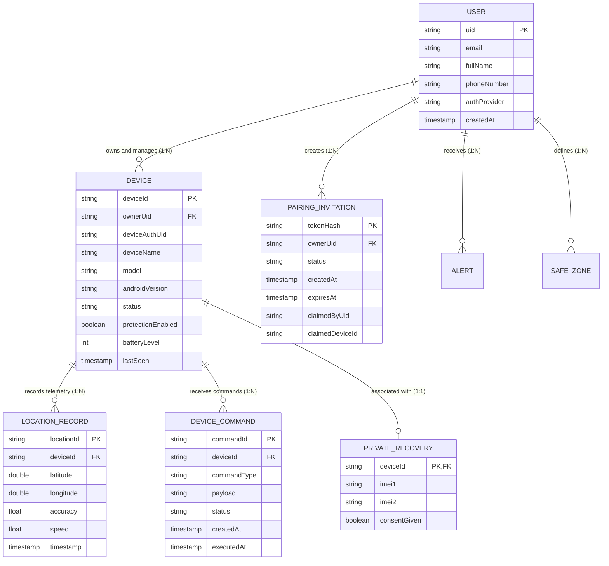

# Entity-Relationship (ER) Model

## 1. ER Diagram

---

## 2. Cardinality & Relationship Breakdown
- **User to Device (1 : N)**: One user account can register and monitor multiple Android smartphones. A smartphone is enrolled to exactly one human owner at a time.
- **Device to Location Record (1 : N)**: Each mobile device continuously pushes location telemetry, forming a detailed temporal track.
- **Device to Device Command (1 : N)**: Owners send queued commands (`LOCATE`, `RING_ALARM`, `LOCK`) to target devices.
- **User to Pairing Invitation (1 : N)**: An owner generates one-time, 10-minute pairing invitations. Each invitation is uniquely keyed by a SHA-256 token hash.
- **Device to Private Recovery (1 : 1)**: Sensitive hardware data (such as optional device IMEIs) is isolated in a private subcollection accessible only by the verified human owner.
