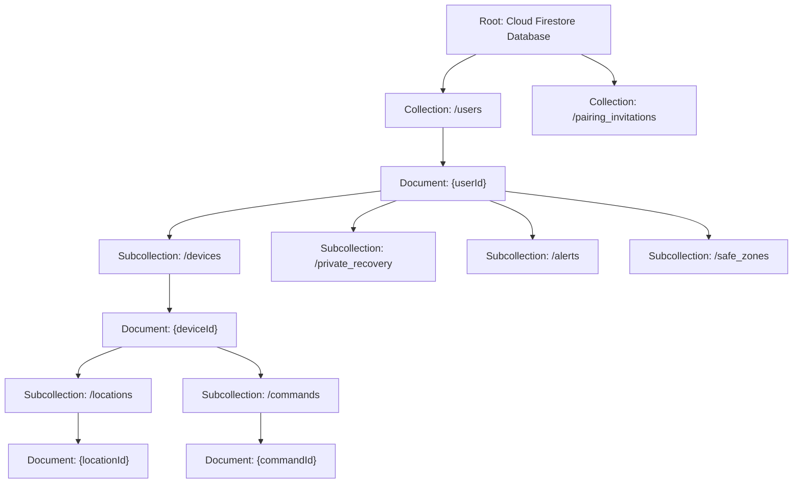

# Hierarchical Database Model

## 1. Hierarchical Tree Paradigm
In the hierarchical database model (reminiscent of IMS and directly mirrored by Cloud Firestore document subcollections), data is structured as an inverted tree with root segments, parent nodes, and dependent children.

---

## 2. SecureTrack Hierarchical Tree

---

## 3. Segment Types and Parent-Child Paths
1. **Root Segment**: Database instance (`(default)`).
2. **First-Level Parent Segment**: `UserDoc` located at `/users/{userId}`.
3. **Second-Level Dependent Segment**:
   - `DeviceDoc` at `/users/{userId}/devices/{deviceId}`.
   - `AlertDoc` at `/users/{userId}/alerts/{alertId}`.
   - `SafeZoneDoc` at `/users/{userId}/safe_zones/{zoneId}`.
4. **Third-Level Dependent Segment**:
   - `LocationDoc` at `/users/{userId}/devices/{deviceId}/locations/{locationId}`.
   - `CommandDoc` at `/users/{userId}/devices/{deviceId}/commands/{commandId}`.

### Hierarchical Integrity Characteristics
- **Cascade Deletion**: In a strict hierarchical model, removing a parent `DeviceDoc` deletes its child telemetry and command nodes.
- **Path Resolution**: Every child record has a single unique hierarchical path enforcing unambiguous ownership boundaries.
