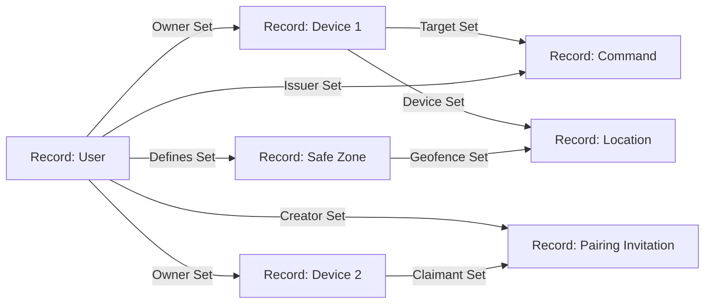

# Network Database Model

## 1. Network Model Concept
In the CODASYL network database model, records are connected through pointers and sets representing many-to-many (M:N) and complex network relationships without strict single-parent limitations.

---

## 2. SecureTrack Network Representation

---

## 3. Network Record Types & Set Memberships

### Record Types
1. **User Record**: Root identity holding owner credentials and metadata.
2. **Device Record**: Represents physical hardware endpoints.
3. **Location Record**: Spatiotemporal telemetry fixes.
4. **Command Record**: Actionable device instructions.
5. **Safe Zone Record**: Circular geographic boundaries.
6. **Pairing Invitation Record**: Dynamic handshake link connecting owner and claimant.

### Member-Owner Set Relationships
- **Device-Location Set**: `Device` is Owner record, `Location` is Member record.
- **Geofence-Location Set**: `Safe Zone` is Owner record, `Location` is Member record (determining whether a location point resides within a boundary).
- **Owner-Command-Device Set**: A dual-parent network set where a `Command` has two owners: the `User` who issued it, and the `Device` that executes it.
- **Invitation-Claimant Set**: Connects the inviting `User` and the claimant `Device` across administrative domains.
