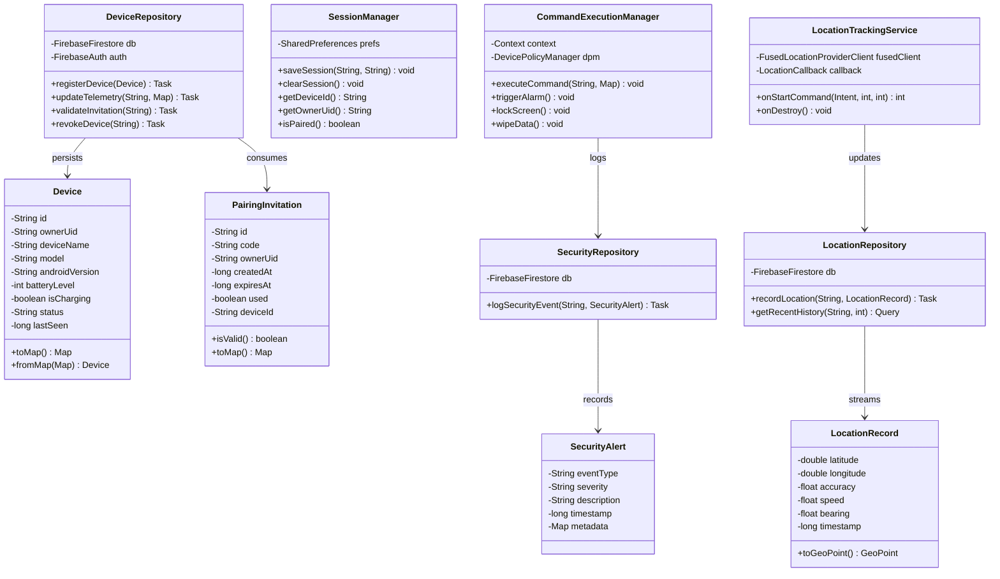

# SecureTrack — Object-Oriented Domain Model

This document outlines the Object-Oriented design, class hierarchies, design patterns, and package organization implemented in the SecureTrack Android client and backend data layer.

---

## 1. Core Class Hierarchy & Class Diagram

The SecureTrack Android client follows clean architecture principles, separating models, repositories, business logic managers, foreground services, and presentation layer activities.



---

## 2. Design Patterns Implemented

### 2.1 Repository Pattern
- **Classes**: `DeviceRepository`, `LocationRepository`, `SecurityRepository`
- **Purpose**: Decouples the presentation layer (`Activity` classes) and background services from direct Firebase SDK calls. Enables unit testing, local caching, and switching storage engines without touching UI code.

### 2.2 Singleton Pattern
- **Classes**: `SessionManager`, `SecureTrackApp`
- **Purpose**: Ensures synchronized access to device credentials, state caching, and application-wide preferences.

### 2.3 Command Pattern
- **Classes**: `CommandExecutionManager`
- **Purpose**: Encapsulates remote telemetry actions (`LOCATE`, `RING`, `LOCK`, `WIPE`) into discrete execution handlers, abstracting system administration APIs and notification managers.

### 2.4 Observer / Reactive Streams
- **Framework**: Firestore snapshot listeners and Android LiveData / Callbacks
- **Purpose**: Automatically propagates command updates and device state changes from the cloud to the device and dashboard in real-time.

---

## 3. Package Organization

```
com.example.securetrack
├── data
│   └── models          # Domain entities (Device, PairingInvitation, LocationRecord)
├── repositories        # Data access layers (DeviceRepository, LocationRepository)
├── security            # Device administration (SecureAdminReceiver)
├── services            # Foreground tracking (LocationTrackingService)
├── managers            # Business logic (CommandExecutionManager, SessionManager)
└── ui                  # Activities and presentation views
    ├── auth            # Login and pairing screens
    ├── registration    # Device linking & QR scanner
    ├── security        # Security controls & permission checks
    └── settings        # App settings & preferences
```
