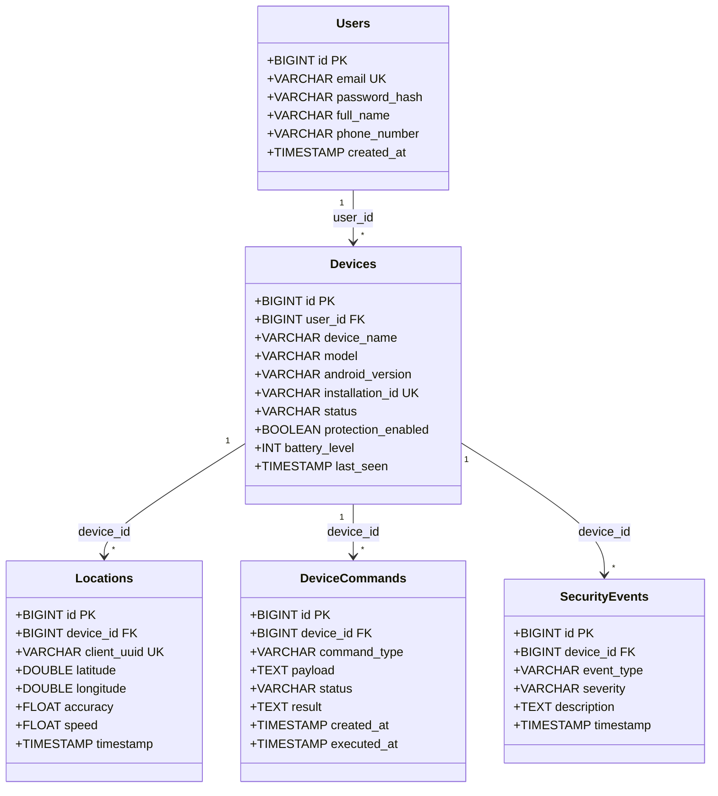

# Relational Database Model

## 1. Relational Database Overview
SecureTrack maintains a full relational database schema reference implemented via MySQL 8.4 and Flyway database migrations (`database/schema.sql` and `backend/src/main/resources/db/migration/V1__init_schema.sql`).

---

## 2. Relational Schema Architecture

---

## 3. Normalization Analysis (1NF to 3NF / BCNF)
- **First Normal Form (1NF)**: Every column holds atomic, scalar values (no repeating groups, arrays, or comma-separated lists).
- **Second Normal Form (2NF)**: All non-key attributes are fully functionally dependent on the entire primary key (`id`), avoiding partial dependencies.
- **Third Normal Form (3NF)**: No transitive dependencies exist (non-key columns do not depend on other non-key columns; device status depends on device primary key).
- **Boyce-Codd Normal Form (BCNF)**: For every functional dependency $X \rightarrow Y$, $X$ is a superkey.

---

## 4. Key Constraints & Referential Integrity
- **Primary Keys**: Surrogate auto-incrementing `BIGINT PRIMARY KEY` on all entities.
- **Unique Constraints**: `users(email)`, `devices(installation_id)`, and `locations(client_uuid)` prevent duplicate identity and replay.
- **Foreign Keys with Cascade**:
  - `fk_device_user`: `ON DELETE CASCADE` removes child devices if an account is closed.
  - `fk_location_device`: `ON DELETE CASCADE` prunes location telemetry when a device is deleted.
- **Performance Indexes**: Compound indexes `(device_id, timestamp)` for high-throughput temporal query execution.
