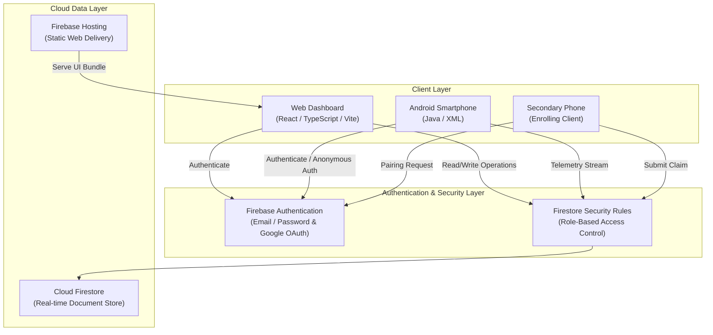

# System Architecture

## Architecture Overview
SecureTrack operates a multi-tier cloud-connected architecture consisting of client endpoints, real-time cloud data storage, and browser-based management interfaces.

---

## 1. Android Application Architecture
- **Presentation Layer**: Java Activities (`MainActivity`, `SplashActivity`, `LoginActivity`, `RegisterActivity`, `DevicesActivity`, `DeviceSecurityActivity`, `DeviceRegistrationActivity`).
- **Data Repositories**:
  - `DeviceRepository`: Handles registration, heartbeat updates, and pairing claims.
  - `LocationRepository`: Captures device coordinates using Google Play Services `FusedLocationProviderClient` and synchronizes to Firestore.
  - `SecurityRepository`: Publishes security alerts and monitors SIM/protection triggers.
- **Background Engine**:
  - `LocationTrackingService`: Android Foreground Service maintaining persistent location tracking with ongoing notification.
  - `CommandExecutionManager`: Listens for queued remote commands (`LOCATE`, `RING_ALARM`, `LOCK`) and reports execution results.
  - `SecureAdminReceiver`: Android `DeviceAdminReceiver` integration for lock commands.

---

## 2. Web Dashboard Architecture
- **Framework**: React 18 with TypeScript and Vite.
- **State & Context**: `AuthContext` managing user authentication session, token lifecycle, and account state.
- **Service Layer (`api.ts`)**:
  - `deviceService`: Subscribes to device lists, generates pairing invitations, approves device enrollments, and handles direct document revocation.
  - `locationService`: Real-time listener on device location history and Leaflet OpenStreetMap rendering.
  - `securityService`: Subscribes to real-time security events and alerts.
- **Routing**: `react-router-dom` with private route guards ensuring unauthenticated visitors are redirected to Login.

---

## 3. Legacy Spring Boot Backend Architecture
- Located in `backend/`, this provides a reference enterprise relational backend using Spring Boot 3.2.5, Spring Security, JWT (JJWT), and Flyway database migrations for MySQL.
- While the active production deployment runs serverlessly on Firebase, the Spring Boot service remains preserved for enterprise SQL evaluation and educational demonstration.
