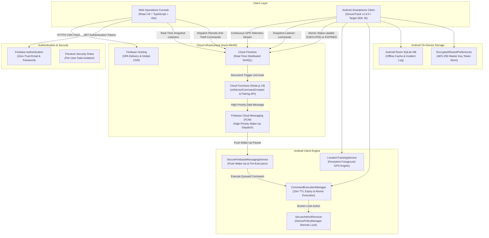

# System Architecture

## Architecture Overview
SecureTrack operates an authenticated, reactive multi-tier cloud-and-device cybersecurity architecture consisting of native Android mobile endpoints, real-time distributed cloud document storage, serverless background trigger pipelines, and a browser-based management console.

---

## 1. Android Application Architecture
- **Presentation Layer**: Native Java Activities & Fragments (`MainActivity`, `SplashActivity`, `LoginActivity`, `RegisterActivity`, `DevicesActivity`, `DeviceSecurityActivity`, `DiagnosticsActivity`, `SettingsActivity`, `HomeFragment`).
- **Data Repositories**:
  - `DeviceRepository`: Handles registration, heartbeat updates, and pairing claims.
  - `LocationRepository`: Captures device coordinates using Google Play Services `FusedLocationProviderClient` and synchronizes to Firestore.
  - `SecurityRepository`: Publishes security alerts, monitors SIM swap triggers, and tracks battery drain events.
- **Background Engine & Services**:
  - `LocationTrackingService`: Android Foreground Service maintaining persistent location tracking with high-accuracy GPS and ongoing notification.
  - `SecureFirebaseMessagingService`: Handles FCM push data wake-ups and initiates instantaneous command processing.
  - `CommandExecutionManager`: Evaluates the **15-minute queue expiration window**, acquires atomic Firestore locks, prevents duplicate execution via client `requestId` tracking, executes commands (`LOCATE_NOW`, `LOCK_DEVICE`, `ALARM_ALERT`, `WIPE_DEVICE`), and reports status.
  - `SecureAdminReceiver`: Android `DeviceAdminReceiver` integration enabling remote screen locking via `DevicePolicyManager.lockNow()`.
  - `ShutdownReceiver` & `BiometricPowerProtectionManager`: Intercepts `ACTION_SHUTDOWN` to record impending pre-shutdown telemetry checkpoints and enforces biometric verification for sensitive settings changes.
  - `GeofenceBroadcastReceiver`: Detects `GEOFENCE_EXIT` and `GEOFENCE_ENTER` boundary transitions, automatically engaging Lost Mode upon zone exit.
- **Local Persistence Layer**:
  - `AppDatabase` (Room SQLite): Local caching of enrolled devices (`cached_devices`), offline security alerts (`security_alerts`), command logs (`commands`), and location breadcrumbs (`locations`).
  - `EncryptedSharedPreferences`: Hardware-backed AES-256 storage for session tokens, encryption keys, and sensitive configuration.

---

## 2. Web Operations Dashboard Architecture
- **Framework**: React 18 with TypeScript and Vite, styled with Tailwind CSS.
- **State & Context**:
  - `AuthContext`: Manages user authentication lifecycle, token refresh, and account identity.
  - `ThemeContext`: Dynamic appearance switching between Light, Dark, and System Default schemes without page reload.
- **Service Layer (`api.ts`)**:
  - `deviceService`: Subscribes to device lists, generates 256-bit pairing invitations, approves enrollments, and executes device deactivation.
  - `locationService`: Real-time listener on telemetry coordinates with Leaflet OpenStreetMap rendering and 4-tier fallback visualization.
  - `securityService`: Subscribes to real-time security alerts and incident feeds.
  - `commandService`: Dispatches anti-theft commands (`LOCATE_NOW`, `LOCK_DEVICE`, `ALARM_ALERT`, `WIPE_DEVICE`), enforces the 15-minute queue expiry window, hard-caps siren playback to 5.0 seconds, and provides fail-closed wipe confirmation barriers.
- **Routing**: `react-router-dom` with private route guards ensuring unauthenticated visitors are redirected to Login.

---

## 3. Serverless Cloud Infrastructure & FCM Pipeline
- **Firebase Authentication**: Zero-trust user identity management via email and password with JWT token verification.
- **Cloud Firestore**: Real-time distributed NoSQL database with hierarchical collections:
  - `users/{uid}/devices/{deviceId}`
  - `users/{uid}/devices/{deviceId}/locations/{locationId}`
  - `users/{uid}/devices/{deviceId}/commands/{commandId}`
  - `users/{uid}/alerts/{alertId}`
- **Cloud Functions (Node.js 18)**:
  - `onDeviceCommandCreated`: Triggered when an anti-theft command document is added; retrieves device FCM registration tokens and dispatches high-priority push payloads.
  - `generateDeviceEnrollmentToken`: Generates cryptographically secure 256-bit pairing tokens (10-minute TTL, SHA-256 hashed).
  - `claimDeviceEnrollment`: Validates and claims pairing tokens securely with owner UID binding.
  - `revokeDevice`: Securely removes device registrations and deauthorizes tokens.
- **Firebase Cloud Messaging (FCM)**: Out-of-band wake-up channel delivering low-latency data packets to dormant Android clients.
- **Firebase Hosting**: High-speed global CDN serving the production Single Page Application.

---

## 4. Legacy Reference Relational Architecture
- Located in `backend/`, this provides an enterprise relational reference backend built with Spring Boot 3.2.5, Spring Security, JWT (JJWT), and Flyway database migrations for MySQL.
- Preserved for academic comparison, database evaluation (NoSQL vs. Relational), and educational demonstration.

---

## 5. Project Leadership & Mentorship
- **Academic Project Guide**: **Mohankumar H M** — DBMS Project Guide & Academic Mentor
- **Project Lead, Owner & Author**: **Dhanush S** ([@dhanushs602848](https://github.com/dhanushs602848))
- **Core Engineering Team**:
  - **Deeksith H G** — Core Security Architecture, Telemetry Systems & Verification
  - **Deeksith K** — Android Client Engineering & Feature Integration
  - **Puneethkumar N E** — Database Architecture, Multi-Device Testing & Verification
  - **Deeksith Raj N** — UI/UX Implementation & Geospatial Mapping Integration
  - **Deepak D S** — Quality Assurance, Hardware Field Testing & Documentation
